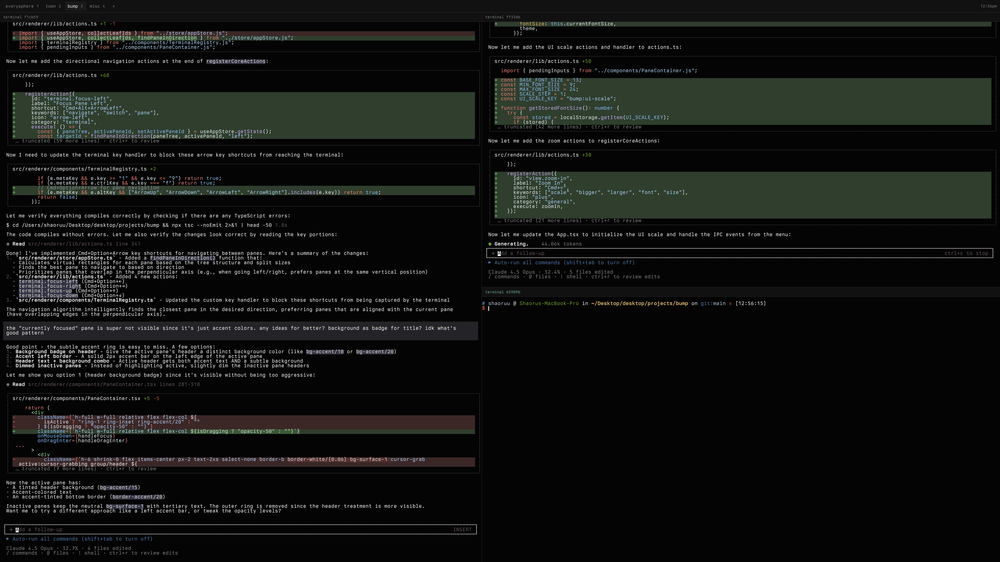

# Bump

A fast, minimal terminal built for ian.



## Development

```bash
pnpm install
pnpm dev
```

## Control server + `bump` CLI + skill

While bump is open it runs a small HTTP control server on `127.0.0.1`, so an
external CLI (and, through it, a Cursor agent) can list and drive terminals,
run commands and read their output, and manage panes, workspaces, and layouts.

The `bump` CLI (Go, in `cli/`) talks to that server, and the `bump-control`
skill (`skills/bump-control/`) teaches a Cursor agent how to use it.

### Build and install

Requires Go (only for the CLI; the JS build never depends on it).

```bash
node scripts/setup-bump-control.mjs   # or: pnpm setup:control
```

This builds the CLI to `~/.local/bin/bump` (already on PATH) and symlinks the
skill into `~/.cursor/skills/bump-control` so Cursor can load it. It is
idempotent - re-run it after pulling changes. To only rebuild the binary, run
`pnpm cli:build` (outputs `cli/bump`).

### CLI

```bash
bump status                       # is bump running? counts + uptime
bump ls                           # list terminals + status (--json for machine output)
bump ps                           # list commands currently running
bump watch [--terminal <id>]      # stream command start/finish events (jsonl with --json)
bump ws                           # list workspaces and their panes
bump run <cmd> [--new|--workspace <id>|--pane <id>]
bump run --wait <cmd> [--timeout 5m]   # block until done; exit with its exit code
bump read <termId> [--lines N]    # print recent output
bump write <termId> <text>        # write raw input (no newline)
bump close <termId>               # close a terminal
bump split <paneId> [--dir h|v] [--cmd "..."]
bump focus <paneId>
bump close-pane <paneId> / bump close-others <paneId>
bump ws-new [dir] / bump ws-switch <id> / bump ws-close <id> / bump ws-rename <id> <name>
```

`--json` gives clean machine-readable output on any command; `--dev` (or
`BUMP_DEV=1`) targets a dev build (`~/.bump-dev`). Run `bump help` for the full
surface.

### Job observability

Every bump terminal is a first-class job. bump injects
[OSC 133](https://gitlab.freedesktop.org/Per_Bothner/specifications/blob/master/proposals/semantic-prompts.md)
shell-integration hooks into the shells it spawns - only those, never your
global `~/.zshrc` / `~/.bashrc` - so it always knows whether a terminal is idle
or running, what the command is, and the last exit code, for commands issued via
the CLI and commands typed by hand. `bump run --wait 'pnpm build' && ...` blocks
on the real exit code, `bump ps` shows what is running, and `bump watch` streams
live done/failed events. If integration cannot load, terminals still work
exactly as before (status `unknown`).

### Notes

- The server only runs while the app is open. It binds to `127.0.0.1` only and
  is gated by a per-session bearer token written to `~/.bump/control.json`, so
  it is not reachable off-machine.
- The HTTP protocol is documented in [`docs/control-protocol.md`](docs/control-protocol.md).

Built by [@shaoruu](https://twitter.com/shaoruu)
